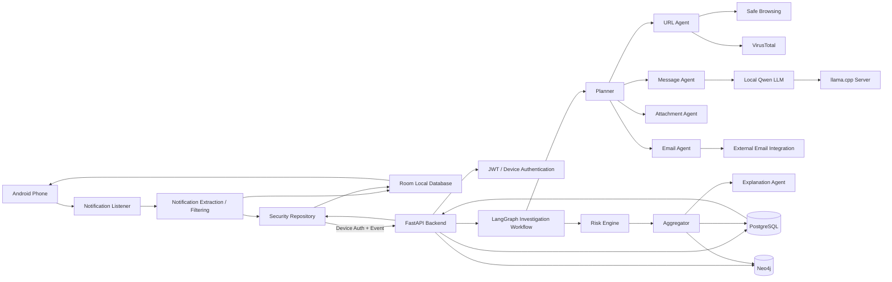

# RAKSHA AI

**RAKSHA AI** is a digital safety and threat-intelligence platform for analyzing suspicious messages, links, and notification events.

The project is organized as a monorepo containing:

- `FRONTEND_APP/` — native Android application built with Kotlin and Android Studio.
- `JWT_BACKEND/` — FastAPI backend with JWT/device authentication, LangGraph-based investigation workflow, PostgreSQL, Neo4j, external threat-intelligence tools, and a local LLM served through `llama.cpp`.

The intended development setup is a Windows PC running the backend/LLM in Docker while a physical Android phone connects to the backend over the same local Wi-Fi network.

---

## 1. What RAKSHA AI Does

RAKSHA AI is designed to detect and explain potentially fraudulent or malicious digital communication.

The Android application can receive supported app notifications through Android's **Notification Listener Service**. The extracted event can contain information such as:

- source/application
- notification title
- notification/message text
- detected URLs
- attachment-related metadata where available
- event/device identifiers

The event is sent to the FastAPI backend, where an investigation workflow can combine:

1. message analysis
2. URL expansion/inspection
3. Google Safe Browsing checks
4. VirusTotal checks
5. attachment-related checks
6. risk aggregation
7. LLM-generated explanation

The result is stored by the backend and surfaced in the Android application.

> **Privacy note:** The current Android design does not require camera-based OCR for notification capture.

---

## 2. High-Level Architecture



---

## 3. Repository Structure

```text
RAKSHA_AI_MAIN/
│
├── .gitignore
│
├── FRONTEND_APP/
│   ├── app/
│   │   └── src/
│   │       └── main/
│   │           ├── java/com/raksha/ai/
│   │           │   ├── data/
│   │           │   ├── network/
│   │           │   ├── notification/
│   │           │   └── ui/
│   │           └── res/
│   ├── gradle/
│   ├── build.gradle.kts
│   ├── gradle.properties
│   ├── settings.gradle.kts
│   ├── gradlew
│   └── gradlew.bat
│
└── JWT_BACKEND/
    ├── app/
    │   ├── agents/
    │   ├── api/
    │   ├── core/
    │   ├── db/
    │   ├── llm/
    │   ├── schemas/
    │   ├── services/
    │   └── tools/
    ├── docker/
    ├── docs/
    ├── migrations/
    ├── tests/
    ├── Dockerfile
    ├── docker-compose.yml
    ├── docker-compose.dev.yml
    ├── requirements.txt
    ├── alembic.ini
    └── .env.example
```

---

# 4. Technology Stack

## Android

- Kotlin
- Android SDK
- Android Studio
- Gradle / Gradle Wrapper
- Room
- OkHttp / HTTP networking
- Android Notification Listener Service
- Android Keystore for device credential protection

## Backend

- Python 3.10.x compatible environment
- FastAPI
- Uvicorn
- Pydantic
- SQLAlchemy
- Alembic
- PostgreSQL
- Neo4j
- JWT/device authentication
- LangGraph investigation workflow
- local `llama.cpp` inference
- Qwen2.5 1.5B Instruct GGUF
- Google Safe Browsing API
- VirusTotal API
- optional Google/Gmail integration

## Infrastructure

- Docker
- Docker Compose
- Docker Desktop
- Caddy for production-style reverse proxying where enabled

---

# 5. Requirements

For the Windows development machine:

- Windows 10/11
- Git
- Docker Desktop
- Android Studio
- JDK 17
- Android SDK
- Android platform/build tools
- A physical Android phone for notification testing
- USB cable for ADB installation/debugging
- PC and phone connected to the same Wi-Fi network for local-network testing

Python `3.10.x` is the supported backend development line for this project. A local Python installation is optional when Docker is used for the backend.

---

# 6. Clone the Repository

Open PowerShell:

```powershell
git clone https://github.com/YOUR_USERNAME/RAKSHA-AI.git
cd RAKSHA-AI
```

The final repository should contain:

```text
FRONTEND_APP
JWT_BACKEND
.gitignore
README.md
```

Do not add old/duplicate project folders that are outside this repository's intended structure.

---

# 7. Backend Setup

Move to the backend directory:

```powershell
cd JWT_BACKEND
```

## 7.1 Create the environment file

The repository contains `.env.example` as a template.

Create your local environment file:

```powershell
Copy-Item .env.example .env
```

Never commit `.env`.

Also never commit:

```text
.env
.env.*
current-api.env
.venv/
```

unless an example/template file is explicitly intended to be public.

Use placeholders in `.env.example`, not real API keys.

---

# 8. Backend Environment Variables

The exact variable names are defined by the project's configuration and `.env.example`.

The important groups are:

### Application

```dotenv
ENVIRONMENT=development
HOST=0.0.0.0
PORT=8000
```

### Database

```dotenv
DATABASE_URL=...
```

### Neo4j

```dotenv
NEO4J_URI=...
NEO4J_USER=...
NEO4J_PASSWORD=...
```

### Local LLM

```dotenv
LLM_PROVIDER_MESSAGE_AGENT=llama_cpp
LLM_PROVIDER_EXPLANATION_AGENT=llama_cpp

LLAMA_CPP_BASE_URL=http://host.docker.internal:8081/v1
LLAMA_CPP_MODEL=raksha-qwen
LLAMA_CPP_TIMEOUT_SECONDS=60
```

### Optional fallback LLM

```dotenv
LLM_FALLBACK_PROVIDER=gemini
```

Only configure external providers that you actually intend to use.

### Threat intelligence

Configure your own API keys in the local `.env` when using:

- Google Safe Browsing
- VirusTotal
- Google/Gmail integration

Do not put these keys into source code or README files.

---

# 9. Docker Desktop

Start Docker Desktop before running any Docker commands.

Check installation:

```powershell
docker --version
docker compose version
```

Then test Docker:

```powershell
docker run --rm hello-world
```

---

# 10. Start the Backend with Docker Compose

The repository includes:

```text
JWT_BACKEND/docker-compose.dev.yml
JWT_BACKEND/docker-compose.yml
```

For local development, use the development compose file.

Because the development setup may reference a `.env.dev` file, create it from the example template when required:

```powershell
Copy-Item .env.example .env.dev
```

Edit `.env.dev` and fill in your local configuration.

Then start the development stack:

```powershell
docker compose -f docker-compose.dev.yml up --build -d
```

Check containers:

```powershell
docker compose -f docker-compose.dev.yml ps
```

View logs:

```powershell
docker compose -f docker-compose.dev.yml logs -f
```

Stop the stack:

```powershell
docker compose -f docker-compose.dev.yml down
```

Stop and remove volumes as well:

```powershell
docker compose -f docker-compose.dev.yml down -v
```

> `down -v` deletes Docker-managed database volumes. Use it only when you intentionally want to reset development data.

---

# 11. Backend Service Verification

After the backend starts, verify the API from the development PC.

### Live health

```powershell
Invoke-RestMethod -Uri "http://localhost:8000/health/live"
```

Expected response:

```json
{
  "status": "ok"
}
```

### Readiness

```powershell
Invoke-RestMethod -Uri "http://localhost:8000/health/ready"
```

### LLM health

```powershell
Invoke-RestMethod -Uri "http://localhost:8000/health/llm"
```

### Swagger

Open in a browser:

```text
http://localhost:8000/docs
```

### OpenAPI

```text
http://localhost:8000/openapi.json
```

---

# 12. PostgreSQL and Neo4j

The backend uses PostgreSQL for relational application data and Neo4j for graph-oriented security/investigation relationships.

Check running containers:

```powershell
docker ps
```

Typical development containers include services corresponding to:

```text
API
LLM
PostgreSQL
Neo4j
```

View a PostgreSQL container's logs:

```powershell
docker logs --tail 100 raksha-postgres
```

View Neo4j logs:

```powershell
docker logs --tail 100 raksha-neo4j
```

When enabled by the deployment configuration, Neo4j Browser is available locally at:

```text
http://localhost:7474
```

Do not publish database credentials in GitHub.

---

# 13. Database Migrations

Alembic migrations are stored under:

```text
JWT_BACKEND/migrations/
```

Run migrations inside the backend container when needed:

```powershell
docker exec raksha-api alembic upgrade head
```

If your compose deployment uses a different service/container name, use the name reported by:

```powershell
docker compose -f docker-compose.dev.yml ps
```

---

# 14. Local LLM Setup

RAKSHA AI can use a local Qwen model through `llama.cpp`.

The configured model for the current setup is:

```text
Qwen2.5-1.5B-Instruct
GGUF
Q4_K_M
```

The official Qwen model repository provides the GGUF quantization variants, including `Q4_K_M`.

Official model page:

https://huggingface.co/Qwen/Qwen2.5-1.5B-Instruct-GGUF

The Q4_K_M model file is approximately 1.12 GB in the official Qwen repository.

---

# 15. Download the Qwen Model

Create a local model directory outside Git tracking:

```powershell
cd C:\RAKSHA_AI_MAIN

New-Item -ItemType Directory -Force -Path .\models
```

Download:

```text
qwen2.5-1.5b-instruct-q4_k_m.gguf
```

from the official Qwen GGUF repository.

Place the file here:

```text
C:\RAKSHA_AI_MAIN\models\qwen-model.gguf
```

The exact filename expected by the tested Docker setup is:

```text
qwen-model.gguf
```

So, if the downloaded file has its original name, rename it:

```powershell
Rename-Item `
  "C:\RAKSHA_AI_MAIN\models\qwen2.5-1.5b-instruct-q4_k_m.gguf" `
  "qwen-model.gguf"
```

Do not commit `.gguf` model files to the repository.

---

# 16. Run llama.cpp with Docker

The project has been tested with the official llama.cpp server image:

```text
ghcr.io/ggml-org/llama.cpp:server
```

The server exposes an OpenAI-compatible API.

Create the container manually when your compose configuration is not already starting the LLM service:

```powershell
docker run -d `
  --name raksha-llm `
  --restart unless-stopped `
  -p 8081:8080 `
  -v "C:\RAKSHA_AI_MAIN\models:/models" `
  ghcr.io/ggml-org/llama.cpp:server `
  -m /models/qwen-model.gguf `
  --host 0.0.0.0 `
  --port 8080 `
  -c 32768 `
  -t 6
```

Explanation:

```text
Host port      : 8081
Container port : 8080
Model path     : /models/qwen-model.gguf
Context        : 32768
Threads        : 6
```

If the compose stack already starts `raksha-llm`, do **not** create a second container with the same role. Use the compose-managed service instead.

---

# 17. Check the LLM Container

```powershell
docker ps --filter "name=raksha-llm"
```

View logs:

```powershell
docker logs --tail 100 raksha-llm
```

Follow logs:

```powershell
docker logs -f raksha-llm
```

The logs should show the model being loaded and the server listening on:

```text
0.0.0.0:8080
```

---

# 18. Test llama.cpp Directly

### Health

```powershell
Invoke-RestMethod -Uri "http://localhost:8081/health"
```

Expected:

```text
status
------
ok
```

### List models

```powershell
Invoke-RestMethod -Uri "http://localhost:8081/v1/models"
```

The project configuration uses:

```text
raksha-qwen
```

as the configured model identifier.

---

# 19. Test an Actual LLM Generation

PowerShell:

```powershell
$body = @{
    model = "raksha-qwen"
    messages = @(
        @{
            role = "user"
            content = "Reply with exactly: MODEL_CONNECTED"
        }
    )
    temperature = 0
    max_tokens = 32
} | ConvertTo-Json -Depth 5

Invoke-RestMethod `
    -Uri "http://localhost:8081/v1/chat/completions" `
    -Method Post `
    -ContentType "application/json" `
    -Body $body
```

The response should contain generated text from the local model.

---

# 20. Connect FastAPI to llama.cpp

The backend container uses Docker Desktop's host gateway to reach the LLM running on the Windows host.

The important configuration is:

```dotenv
LLAMA_CPP_BASE_URL=http://host.docker.internal:8081/v1
LLAMA_CPP_MODEL=raksha-qwen
```

Test connectivity from inside the API container:

```powershell
docker exec raksha-api python -c "import urllib.request; print(urllib.request.urlopen('http://host.docker.internal:8081/health', timeout=10).read().decode())"
```

Expected:

```json
{"status":"ok"}
```

Then check the backend's LLM health:

```powershell
Invoke-RestMethod -Uri "http://localhost:8000/health/llm"
```

The response should indicate that the message and explanation agents are configured to use `llama_cpp`.

---

# 21. Important LLM Notes

RAKSHA AI's local inference path is:

```text
FastAPI
   |
   v
LangGraph workflow
   |
   v
Message Agent / Explanation Agent
   |
   v
llama.cpp
   |
   v
Qwen2.5-1.5B-Instruct GGUF
```

This avoids depending on a paid hosted LLM for the primary inference path.

External services such as Safe Browsing and VirusTotal are independent of the local LLM and may still require API credentials.

---

# 22. Android Application Setup

Open Android Studio.

Choose:

```text
Open
```

and select:

```text
RAKSHA-AI/FRONTEND_APP
```

Allow Android Studio to complete:

- Gradle sync
- SDK setup
- indexing
- dependency resolution

The project includes the Gradle Wrapper, so use the included wrapper rather than relying on a globally installed Gradle version.

---

# 23. JDK Setup

The Android project is intended to use **JDK 17**.

In Android Studio:

```text
File
→ Settings
→ Build, Execution, Deployment
→ Build Tools
→ Gradle
```

Set the Gradle JDK to JDK 17.

Verify from PowerShell:

```powershell
java -version
```

The version should report Java 17.

---

# 24. Android Backend URL

The Android application gets the backend URL from:

```text
BuildConfig.BACKEND_BASE_URL
```

The project reads the Gradle property:

```text
RAKSHA_BACKEND_URL
```

For a physical phone, **do not use**:

```text
http://127.0.0.1:8000/
```

because on Android this points to the phone itself.

Use the Windows PC's LAN IPv4 address:

```text
http://<PC-LAN-IP>:8000/
```

Example:

```text
http://192.168.0.102:8000/
```

Do not permanently copy a developer's private LAN IP into a public README.

---

# 25. Build the APK with a Custom Backend URL

From:

```powershell
cd C:\RAKSHA_AI_MAIN\FRONTEND_APP
```

build with:

```powershell
.\gradlew.bat assembleDebug -PRAKSHA_BACKEND_URL=http://<PC-LAN-IP>:8000/
```

The generated APK is normally:

```text
FRONTEND_APP/app/build/outputs/apk/debug/app-debug.apk
```

---

# 26. Find the PC's LAN IP

On Windows:

```powershell
ipconfig
```

Look under your active Wi-Fi adapter for:

```text
IPv4 Address
```

For example:

```text
192.168.0.102
```

Use that address in the Android build.

Your phone and PC must be connected to the same reachable network.

---

# 27. Test Backend Reachability from the Phone

Before installing/testing the complete notification flow, open Chrome on the Android phone and visit:

```text
http://<PC-LAN-IP>:8000/health/live
```

For example:

```text
http://192.168.0.102:8000/health/live
```

If the endpoint returns a healthy response, the phone can reach the backend.

If it does not load, diagnose the network before debugging the Android app.

---

# 28. Windows Firewall

If the phone cannot reach port `8000`, Windows Firewall may be blocking inbound connections.

A development-only firewall rule can be created with:

```powershell
New-NetFirewallRule `
  -DisplayName "RAKSHA API 8000" `
  -Direction Inbound `
  -Protocol TCP `
  -LocalPort 8000 `
  -Action Allow
```

Use the narrowest firewall/network policy appropriate for your environment.

Do not expose a development API directly to the public internet.

---

# 29. Install ADB

Android Studio normally includes ADB with the Android SDK platform tools.

Check:

```powershell
adb version
```

If `adb` is not found, use the full path to the SDK's `platform-tools` directory or add it to PATH.

---

# 30. Connect the Android Phone

On Android:

1. Enable **Developer Options**.
2. Enable **USB debugging**.
3. Connect the phone to the PC by USB.
4. Accept the RSA debugging prompt on the phone.

Then:

```powershell
adb devices
```

Expected:

```text
List of devices attached
XXXXXXXX    device
```

If the status is:

```text
unauthorized
```

unlock the phone and accept the USB debugging prompt.

---

# 31. Build and Install the Debug APK

Build:

```powershell
cd C:\RAKSHA_AI_MAIN\FRONTEND_APP

.\gradlew.bat assembleDebug -PRAKSHA_BACKEND_URL=http://<PC-LAN-IP>:8000/
```

Install:

```powershell
adb install -r .\app\build\outputs\apk\debug\app-debug.apk
```

If an older development version is installed and credential state is causing problems, uninstall it first:

```powershell
adb uninstall com.raksha.ai
```

Then reinstall:

```powershell
adb install .\app\build\outputs\apk\debug\app-debug.apk
```

The final application ID should be verified from the current Gradle configuration if it changes in future versions.

---

# 32. Android Notification Access

RAKSHA AI relies on Android's Notification Listener mechanism for supported notification capture.

On the phone:

```text
Settings
→ Notifications / Special App Access
→ Notification Access
```

Find the RAKSHA AI application and grant notification access.

Android settings labels vary by device manufacturer and Android version.

After enabling access, generate a test notification from a supported application.

---

# 33. Complete End-to-End Test

Start the infrastructure first.

### Terminal 1 — backend

```powershell
cd C:\RAKSHA_AI_MAIN\JWT_BACKEND
docker compose -f docker-compose.dev.yml up --build
```

### Terminal 2 — LLM logs

```powershell
docker logs -f raksha-llm
```

If the LLM is compose-managed, use:

```powershell
docker compose -f docker-compose.dev.yml logs -f
```

### Terminal 3 — Android

```powershell
adb logcat
```

Now:

1. Launch RAKSHA AI.
2. Confirm notification access is enabled.
3. Send a test message/notification.
4. Verify Android receives the notification event.
5. Verify the backend receives `POST /api/v1/events/analyze`.
6. Verify the investigation workflow starts.
7. Verify URL tools execute when URLs are present.
8. Verify the local LLM receives `/v1/chat/completions`.
9. Verify analysis completes.
10. Verify the result becomes available to the Android application.

---

# 34. Useful Backend Logs

Follow API logs:

```powershell
docker logs -f raksha-api
```

The analysis path can produce logs conceptually similar to:

```text
event_received
analysis_started
agent_started
agent_completed
analysis_completed
```

For LLM traffic, the API should reach:

```text
http://host.docker.internal:8081/v1/chat/completions
```

---

# 35. Useful Android Logcat Filters

To focus on RAKSHA AI logs:

```powershell
adb logcat | findstr "RAKSHA"
```

For HTTP-related logs:

```powershell
adb logcat | findstr "RAKSHA_HTTP"
```

For exceptions:

```powershell
adb logcat | findstr "Exception"
```

For a combination:

```powershell
adb logcat | findstr /I "RAKSHA SocketTimeoutException Exception HTTP"
```

---

# 36. Authentication Flow

The Android application uses device-oriented authentication.

The general flow is:

```text
Android App
   |
   | Device Registration
   v
FastAPI /api/v1/auth/device/register
   |
   v
Access Token
   |
   v
Android Credential Store
   |
   v
Authenticated Event Request
```

The Android application stores the device token using protected credential handling rather than placing a long-lived secret directly in source code.

---

# 37. Android Keystore Requirement

The project uses Android Keystore for local token encryption.

A common error during development is:

```text
Cannot Initialize without a android.security.keystore.KeyGenParameterSpec parameter
```

The Android AES key generator must use an Android `KeyGenParameterSpec` for the `AndroidKeyStore` provider.

When testing a newly corrected credential-store implementation, uninstalling the previous development build can clear stale key/credential state:

```powershell
adb uninstall <APPLICATION_ID>
```

Then install the new APK.

---

# 38. Native Python Backend Setup (Optional)

Docker is the recommended development path, but the backend can also be run directly with Python.

From:

```powershell
cd C:\RAKSHA_AI_MAIN\JWT_BACKEND
```

Create a virtual environment:

```powershell
py -3.10 -m venv .venv
```

Activate it:

```powershell
.\.venv\Scripts\Activate.ps1
```

Install dependencies:

```powershell
python -m pip install --upgrade pip
pip install -r requirements.txt
```

Run migrations:

```powershell
alembic upgrade head
```

Start FastAPI:

```powershell
uvicorn app.main:app --host 0.0.0.0 --port 8000 --reload
```

The `.venv` directory must remain local and must never be committed to GitHub.

---

# 39. Testing

Backend tests are located under:

```text
JWT_BACKEND/tests/
```

Run them in the virtual environment:

```powershell
cd C:\RAKSHA_AI_MAIN\JWT_BACKEND

.\.venv\Scripts\Activate.ps1

pytest
```

Run a specific test module:

```powershell
pytest tests/test_jwt_auth.py
```

Run:

```powershell
pytest tests/test_schemas.py
```

---

# 40. Common Docker Commands

### List all containers

```powershell
docker ps -a
```

### Start a stopped container

```powershell
docker start raksha-api
```

### Restart

```powershell
docker restart raksha-api
```

### Stop

```powershell
docker stop raksha-api
```

### Remove a container

```powershell
docker rm -f raksha-api
```

### View API logs

```powershell
docker logs --tail 200 raksha-api
```

### Follow API logs

```powershell
docker logs -f raksha-api
```

### View LLM logs

```powershell
docker logs --tail 200 raksha-llm
```

### Inspect container environment

Do not commit the resulting output:

```powershell
docker inspect raksha-api
```

Avoid redirecting container environment variables into tracked files.

---

# 41. Common Network Problem: Android Cannot Reach the API

### Wrong

```text
http://127.0.0.1:8000/
```

### Correct for a phone talking to the PC

```text
http://<PC-LAN-IP>:8000/
```

Verify on the PC:

```powershell
Get-NetTCPConnection -LocalPort 8000 -State Listen
```

The API should listen on:

```text
0.0.0.0:8000
```

Test from the PC:

```powershell
Test-NetConnection <PC-LAN-IP> -Port 8000
```

Test from the phone browser:

```text
http://<PC-LAN-IP>:8000/health/live
```

Only after this succeeds should Android application networking be investigated.

---

# 42. Common LLM Problem: FastAPI Is Up but LLM Is Not Responding

Check the LLM:

```powershell
Invoke-RestMethod -Uri "http://localhost:8081/health"
```

Check models:

```powershell
Invoke-RestMethod -Uri "http://localhost:8081/v1/models"
```

Test from API container:

```powershell
docker exec raksha-api python -c "import urllib.request; print(urllib.request.urlopen('http://host.docker.internal:8081/health', timeout=10).read().decode())"
```

Check backend LLM health:

```powershell
Invoke-RestMethod -Uri "http://localhost:8000/health/llm"
```

Check logs:

```powershell
docker logs --tail 200 raksha-llm
docker logs --tail 200 raksha-api
```

---

# 43. Common Analysis Problem: API Receives the Request but No LLM Call Appears

The analysis endpoint is designed to avoid unnecessary duplicate processing.

When debugging an analysis request, use a **new event ID**.

Reusing an existing event ID can result in an existing analysis being returned instead of starting a new investigation workflow.

When testing:

```text
event_id = fresh UUID / fresh test identifier
```

Then check API logs for:

```text
event_received
analysis_started
agent_started
agent_completed
analysis_completed
```

At the same time check the LLM logs for a new request.

---

# 44. Common Android Problem: "COULDN'T VERIFY" / "Could not verify instantly"

Treat this message as a generic UI failure state.

Check the Android Logcat for the actual underlying exception.

Useful filter:

```powershell
adb logcat | findstr /I "RAKSHA Exception Keystore SocketTimeoutException"
```

Then separately verify:

1. backend URL
2. phone-to-PC connectivity
3. device registration
4. authentication token
5. backend event request
6. LLM health
7. analysis workflow logs

---

# 45. Release Build Considerations

Local HTTP is appropriate for a controlled development LAN test.

A production deployment should use:

```text
HTTPS
```

rather than exposing a development HTTP API directly.

The repository contains:

```text
JWT_BACKEND/docker/Caddyfile
JWT_BACKEND/docs/PRODUCTION_DEPLOYMENT.md
```

for production-oriented deployment documentation.

Before publishing a production Android build:

- use a production API hostname
- use HTTPS
- review Android Network Security Configuration
- replace development secrets
- remove test credentials
- sign the application with a release keystore
- verify notification-access behavior on target Android versions
- test token lifecycle and logout/revocation

---

# 46. Git and Secret Safety

The repository intentionally ignores environment and generated files.

Before every commit:

```powershell
git status
```

Check tracked files:

```powershell
git ls-files
```

Check that sensitive files are not tracked:

```powershell
git ls-files JWT_BACKEND/.env JWT_BACKEND/current-api.env JWT_BACKEND/.venv
```

Expected result:

```text
(no output)
```

Never commit:

```text
JWT_BACKEND/.env
JWT_BACKEND/.env.dev
JWT_BACKEND/current-api.env
JWT_BACKEND/.venv/
*.gguf
*.apk
*.aab
```

If a real API key has ever been committed to a public or shared Git repository, deleting the file later is not enough. Rotate the credential and remove it from Git history.

---

# 47. Recommended Development Startup Order

Use this order for a clean local run:

```text
1. Start Docker Desktop
2. Start PostgreSQL / Neo4j
3. Start llama.cpp + Qwen
4. Start FastAPI
5. Check /health/live
6. Check /health/llm
7. Check Swagger /docs
8. Confirm PC LAN IP
9. Build Android APK with RAKSHA_BACKEND_URL
10. Install APK
11. Grant Notification Access
12. Generate a test notification
13. Watch Android logcat
14. Watch API logs
15. Watch LLM logs
16. Confirm final analysis
```

---

# 48. Quick Start — Windows

After the machine has all prerequisites installed:

### Terminal 1

```powershell
cd C:\RAKSHA_AI_MAIN\JWT_BACKEND

Copy-Item .env.example .env.dev

docker compose -f docker-compose.dev.yml up --build
```

### Terminal 2

```powershell
cd C:\RAKSHA_AI_MAIN\FRONTEND_APP

.\gradlew.bat assembleDebug -PRAKSHA_BACKEND_URL=http://<PC-LAN-IP>:8000/
```

### Install

```powershell
adb install -r .\app\build\outputs\apk\debug\app-debug.apk
```

### Verify backend

```powershell
Invoke-RestMethod -Uri "http://localhost:8000/health/live"
```

### Verify LLM

```powershell
Invoke-RestMethod -Uri "http://localhost:8081/health"
```

### Verify phone connectivity

Open on the phone:

```text
http://<PC-LAN-IP>:8000/health/live
```

Then launch RAKSHA AI and enable Notification Access.

---

# 49. Project Components

## Android Data Layer

```text
data/
├── RakshaApplication.kt
├── RakshaDatabase.kt
├── SecurityEventDao.kt
├── SecurityEventEntity.kt
├── SecurityRepository.kt
└── SettingsStore.kt
```

Responsible for local persistence, repositories, and application state.

## Android Network Layer

```text
network/
├── ApiClient.kt
├── DeviceAuthInterceptor.kt
├── DeviceCredentialStore.kt
├── NetworkConfig.kt
└── SecurityApi.kt
```

Responsible for backend communication and device authentication.

## Android Notification Layer

```text
notification/
├── AttachmentDetector.kt
├── NotificationExtractor.kt
├── NotificationFilter.kt
├── NotificationListenerService.kt
├── NotificationPackages.kt
├── NotificationParser.kt
├── RecentNotificationDeduper.kt
├── SecurityEventBus.kt
└── UrlExtractor.kt
```

Responsible for notification capture, parsing, filtering, deduplication, and URL extraction.

## Android UI

```text
ui/
├── MainActivity.kt
├── alerts/
├── dashboard/
├── detail/
├── history/
├── onboarding/
└── settings/
```

---

# 50. Backend Components

## Agents

```text
app/agents/
├── nodes/
│   ├── aggregator.py
│   ├── attachment_agent.py
│   ├── email_agent.py
│   ├── explanation_agent.py
│   ├── message_agent.py
│   ├── planner.py
│   ├── risk_engine.py
│   └── url_agent.py
├── prompts.py
├── state.py
└── workflow.py
```

The agent graph coordinates investigation tasks and combines their results.

## API

```text
app/api/
├── auth.py
├── deps.py
├── email.py
└── events.py
```

## Data

```text
app/db/
├── models.py
├── neo4j.py
├── repositories.py
└── session.py
```

## LLM

```text
app/llm/
└── llama_cpp.py
```

## Tools

```text
app/tools/
├── file_hash.py
├── safe_browsing.py
├── similarity.py
├── url_expander.py
└── virustotal.py
```

---

# 51. Security Design

RAKSHA AI has several security-oriented layers:

```text
Android Device
   ↓
Device Authentication
   ↓
JWT Protected API
   ↓
Investigation Workflow
   ↓
Threat Intelligence
   ↓
Risk Engine
   ↓
LLM Explanation
```

Security-sensitive credentials should be stored only in environment configuration or a managed secret store.

The local LLM deployment keeps the primary language-model inference on the configured host rather than requiring every message to be sent to a hosted LLM provider.

External threat-intelligence integrations can still send the specific indicators required by those services, so review privacy/legal requirements before enabling them for sensitive production traffic.

---

# 52. Troubleshooting Checklist

When something fails, identify the first layer that is broken.

### Layer 1 — Docker

```powershell
docker ps
```

### Layer 2 — API

```powershell
Invoke-RestMethod "http://localhost:8000/health/live"
```

### Layer 3 — LLM

```powershell
Invoke-RestMethod "http://localhost:8081/health"
```

### Layer 4 — API → LLM

```powershell
docker exec raksha-api python -c "import urllib.request; print(urllib.request.urlopen('http://host.docker.internal:8081/health', timeout=10).read().decode())"
```

### Layer 5 — Phone → API

Phone browser:

```text
http://<PC-LAN-IP>:8000/health/live
```

### Layer 6 — Android → API

```powershell
adb logcat | findstr /I "RAKSHA HTTP Exception"
```

### Layer 7 — Notification capture

Verify Notification Access is enabled.

### Layer 8 — Workflow

Check:

```powershell
docker logs -f raksha-api
```

### Layer 9 — LLM inference

Check:

```powershell
docker logs -f raksha-llm
```

---

# 53. Useful URLs During Development

| Component | URL |
|---|---|
| FastAPI live health | `http://localhost:8000/health/live` |
| FastAPI readiness | `http://localhost:8000/health/ready` |
| FastAPI LLM health | `http://localhost:8000/health/llm` |
| FastAPI Swagger | `http://localhost:8000/docs` |
| FastAPI OpenAPI | `http://localhost:8000/openapi.json` |
| llama.cpp health | `http://localhost:8081/health` |
| llama.cpp models | `http://localhost:8081/v1/models` |
| Neo4j Browser | `http://localhost:7474` |

---

# 54. Official References

- llama.cpp: https://github.com/ggml-org/llama.cpp
- llama.cpp server documentation: https://github.com/ggml-org/llama.cpp/tree/master/tools/server
- Qwen2.5 1.5B Instruct GGUF: https://huggingface.co/Qwen/Qwen2.5-1.5B-Instruct-GGUF
- FastAPI: https://fastapi.tiangolo.com/
- LangGraph: https://docs.langchain.com/oss/python/langgraph
- Docker: https://docs.docker.com/
- Neo4j: https://neo4j.com/docs/
- PostgreSQL: https://www.postgresql.org/docs/
- Android Developer Documentation: https://developer.android.com/

---

# 55. Current Development Model

The current development architecture is:

```text
                     WINDOWS DEVELOPMENT PC
┌─────────────────────────────────────────────────────────┐
│                                                         │
│  Docker                                                 │
│  ┌─────────────────┐      ┌────────────────────────┐    │
│  │ FastAPI API     │ ───► │ llama.cpp               │    │
│  │ port 8000       │      │ port 8081 → 8080       │    │
│  └────────┬────────┘      │ Qwen2.5-1.5B GGUF      │    │
│           │               └────────────────────────┘    │
│           │                                              │
│     ┌─────┴─────────┐                                    │
│     │               │                                    │
│ PostgreSQL       Neo4j                                   │
│                                                         │
└───────────────────────────────┬─────────────────────────┘
                                │
                          Local Wi-Fi
                                │
                                ▼
                    ┌─────────────────────┐
                    │ Android Phone       │
                    │                     │
                    │ RAKSHA AI           │
                    │ Notification        │
                    │ Listener            │
                    │                     │
                    │ HTTP → port 8000    │
                    └─────────────────────┘
```

---

# 56. Production Direction

For deployment beyond local development, the intended direction is:

```text
Android App
     |
     | HTTPS
     v
Public API / Reverse Proxy
     |
     v
FastAPI
     |
     +---- PostgreSQL
     |
     +---- Neo4j
     |
     +---- Local/Hosted LLM
     |
     +---- Threat Intelligence APIs
```

Production deployment should use:

- HTTPS
- proper DNS
- protected secrets
- secure database networking
- restricted firewall rules
- production JWT configuration
- release-signed Android builds
- monitoring/logging
- rate limiting
- backups
- controlled access to Neo4j/PostgreSQL
- a production LLM host sized for expected traffic

See:

```text
JWT_BACKEND/docs/PRODUCTION_DEPLOYMENT.md
```

for project-specific deployment notes.

---

# 57. License and Third-Party Components

Before publishing a public repository, verify and document licenses for:

- the RAKSHA AI source code
- Qwen model weights
- llama.cpp
- Android dependencies
- Python packages
- LangGraph/LangChain components
- PostgreSQL
- Neo4j
- Caddy
- any external API usage

The official Qwen2.5-1.5B-Instruct GGUF repository identifies the model as Apache 2.0 licensed. Always review the current model card and the license for the exact artifact being distributed.

---

# 58. Contribution Workflow

Create a branch:

```powershell
git checkout -b feature/your-feature
```

Make changes, then:

```powershell
git status
git add FRONTEND_APP JWT_BACKEND
git commit -m "Describe the change"
git push -u origin feature/your-feature
```

Before opening a pull request:

```powershell
pytest
```

and:

```powershell
cd ..\FRONTEND_APP
.\gradlew.bat assembleDebug
```

---

# 59. Important Notes

### Do not commit the virtual environment

This directory:

```text
JWT_BACKEND/.venv/
```

is a local Python environment only.

### Do not commit the model

This directory:

```text
models/
```

and files such as:

```text
*.gguf
```

should remain outside Git tracking.

### Do not commit secrets

Never push:

```text
.env
.env.dev
API keys
JWT secrets
database passwords
Google credentials
service-account JSON files
Docker environment dumps
```

### Do not expose development ports publicly

Ports such as:

```text
8000
8081
7474
7687
5432
```

should be treated as development/infrastructure ports and protected appropriately.

---

# 60. Maintainer Quick Reference

### Clone

```powershell
git clone https://github.com/YOUR_USERNAME/RAKSHA-AI.git
cd RAKSHA-AI
```

### Backend

```powershell
cd JWT_BACKEND
Copy-Item .env.example .env.dev
docker compose -f docker-compose.dev.yml up --build
```

### Backend health

```powershell
Invoke-RestMethod "http://localhost:8000/health/live"
Invoke-RestMethod "http://localhost:8000/health/llm"
```

### LLM

```powershell
Invoke-RestMethod "http://localhost:8081/health"
Invoke-RestMethod "http://localhost:8081/v1/models"
```

### Android

```powershell
cd ..\FRONTEND_APP
.\gradlew.bat assembleDebug -PRAKSHA_BACKEND_URL=http://<PC-LAN-IP>:8000/
adb install -r .\app\build\outputs\apk\debug\app-debug.apk
```

### Logs

```powershell
docker logs -f raksha-api
docker logs -f raksha-llm
adb logcat | findstr /I "RAKSHA Exception HTTP"
```

---

## RAKSHA AI

**Digital Safety • Threat Intelligence • Agentic Investigation • Local AI**
